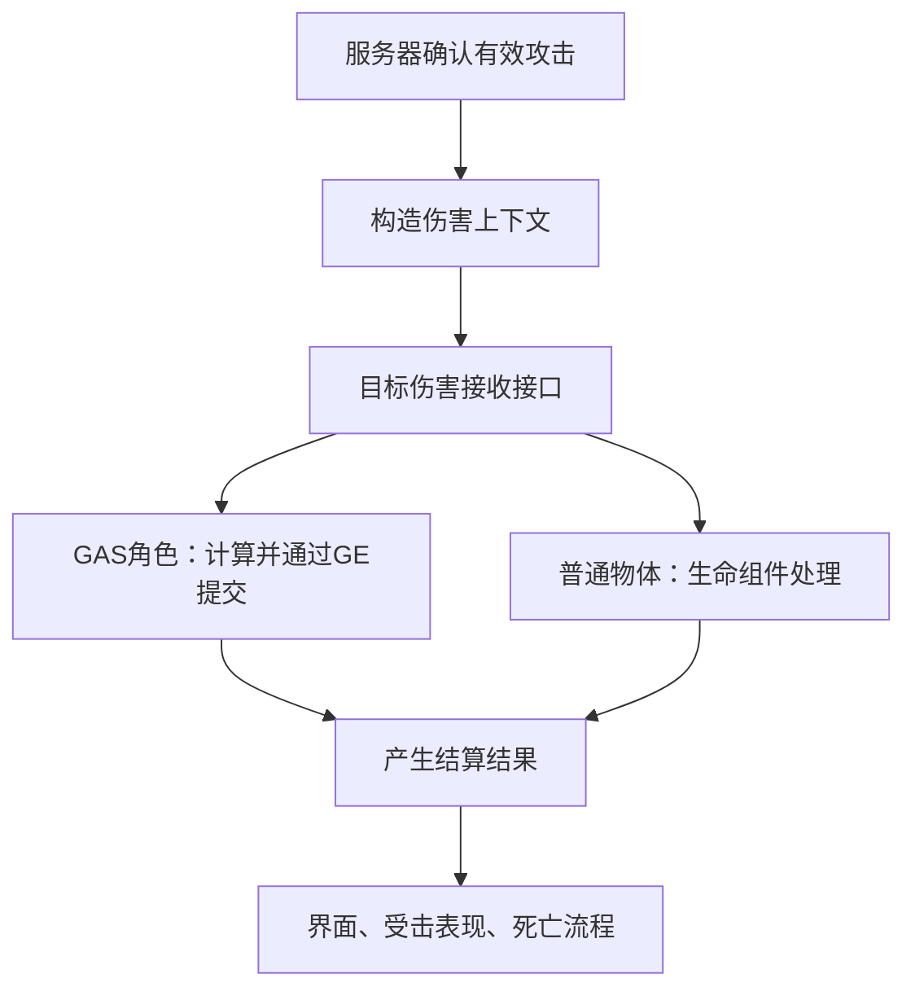

**第 03 期｜UE5 动作游戏客户端面试练习｜2026 年 11 月 23 日**

本期围绕“数据怎样传递、属性怎样计算、伤害怎样落地”展开，难度为基础到中级。

|题目|主要方向|考察重点|
|---|---|---|
|1. C++ 中什么时候拷贝、引用或移动？UE 的 `MoveTemp` 做了什么？|C++、容器与性能|参数设计、资源转移、返回值优化|
|2. GAS 的 BaseValue 与 CurrentValue 有什么区别？增益和中毒叠加怎样设计？|GAS、战斗数值|属性计算、效果生命周期、叠加规则|
|3. 玩家、敌人和可破坏物怎样共用伤害系统？|角色架构、动作战斗、网络|接口、组件、委托、权威数据来源|

建议先独立口述，再看解析。示例代码为讲解片段，省略完整类声明、头文件及项目配置。

---

**第 1 题：C++ 中什么时候拷贝、引用或移动？UE 的 `MoveTemp` 做了什么？**

**题干**

一次近战检测得到 `TArray<FHitResult>`，你需要把结果交给筛选函数、修改函数和缓存组件。分别应该怎样传参？`MoveTemp` 是否会直接搬走数据？函数返回局部数组时，是否应该写 `return MoveTemp(Result)`？

**面试口述版**

我会根据函数是否修改数据、是否需要保存独立副本来设计参数。只读且拷贝较贵的数据通常用 `const T&`，原地修改用 `T&`，需要接收并保存数据时，可以使用按值接收后移动，或提供明确的右值引用接口。

`MoveTemp` 本身只进行类型转换，让后续构造或赋值有机会选择移动操作；真正转移资源的是移动构造或移动赋值。返回局部容器通常直接 `return Result`，保留返回值优化机会。

**核心原理与详细答案**

**① 参数类型首先表达使用方式。**

|形式|表达的意图|典型用途|
|---|---|---|
|`T`|接收一个值|小型值类型；函数需要自己的副本|
|`const T&`|只读借用|查询、筛选、统计大型对象或容器|
|`T&`|修改调用方对象|原地排序、移除无效命中|
|`T&&`|允许消耗传入对象的资源|明确接收资源转移的接口|

不能把“引用更快”当成通用规则。`int32` 等小类型通常直接按值传递；对大容器，则需要避免无意义的整份复制。

**② 拷贝与移动解决不同需求。**

对于普通 `TArray`：

- **拷贝**：创建独立的数组存储，并复制元素。
- **移动**：在类型和分配器允许时接管已有资源，通常可以避免逐元素复制。
- **借用引用**：不创建独立数组，也不接管资源，必须遵守原对象的生命周期。

UE 的主要容器支持移动构造和移动赋值。但不能推导出“所有类型的移动都是零成本”，具体成本仍取决于类型与实现。

**③ `MoveTemp` 只提供移动机会。**

```
MoveTemp(Hits);                 // 单独写，不会完成资源转移
CachedHits = MoveTemp(Hits);    // 真正的操作发生在赋值中
```

第二行是否调用移动赋值，要由目标类型的重载决定。

UE 的 `MoveTemp` 比 `std::move` 更严格：传入 `const` 对象或右值等无效使用时会编译失败。因此，不能照搬“对 const 对象调用 MoveTemp 也能高效移动”的说法。

**实际项目应用**

假设以下函数位于命中结果缓存组件中，`CachedHits` 是其成员：

```
// 只读借用：调用方保留数据。
void InspectHits(const TArray<FHitResult>& InHits);

// 原地修改：例如删除不满足条件的结果。
void FilterHits(TArray<FHitResult>& InOutHits);

// 接收并保存一份数据。
void SetHits(TArray<FHitResult> InHits)
{
    CachedHits = MoveTemp(InHits);
}
```

两种调用的区别：

```
SetHits(Hits);             // Hits 拷贝到参数，再移动到成员
SetHits(MoveTemp(Hits));   // 允许从 Hits 移动，再移动到成员
```

选择依据是业务需求：

- 后续还需要原始 `Hits`：保留它，接受必要的拷贝。
- 当前已经是最后一次使用，希望把结果交给组件：可以移动。
- 筛选函数只是临时读取：使用 `const&`，无需复制。

移动后对象仍然存在，但不能继续依赖它保存着原来的内容；后续操作应遵守该类型对移动后状态的约定。

遍历时也要注意：

```
for (const FHitResult& Hit : Hits)
{
    // 读取命中信息，避免每次循环复制整个元素。
}
```

**常见误区**

- **“所有参数都改成右值引用，性能最好。”**  
    参数类型应表达用途，不能为了“看起来高效”强迫调用方交出数据。
- **“`MoveTemp` 调用之后，对象就不存在了。”**  
    对象仍存在，改变的是它所管理的资源和状态。
- **“返回局部数组的引用能省一次复制。”**  
    局部对象离开函数后被销毁，返回其引用会悬空。
- **“按值返回容器一定很慢。”**  
    返回值优化和移动语义可以消除或降低中间传递成本。

**深入追问**

**追问 A：为什么通常不写 `return MoveTemp(Result)`？**

对于符合条件的局部变量，直接返回可以让编译器执行 **NRVO，具名返回值优化**，直接在调用方的结果位置构造对象。

显式加上移动转换，反而会破坏这种 NRVO 机会。具名局部变量的 NRVO 并非无条件保证，但没有执行 NRVO 时，通常仍有隐式移动机会。

**追问 B：调用 `Reserve` 后，可以一直保存数组元素的指针吗？**

不能。`Reserve` 可以减少容量不足引起的重新分配，但之后超出容量、插入、删除或调整元素位置，仍可能让已保存的指针、引用失效，或不再代表原来的元素。

战斗代码如果需要长期标识某个对象，应该使用明确的对象引用或稳定标识，不能把数组元素地址当成永久身份。

**术语注释**

`Copy Semantics`：拷贝语义；`Move Semantics`：移动语义；`Lvalue/Rvalue`：左值／右值，属于表达式分类；`Move Assignment`：移动赋值；`NRVO`：具名返回值优化。

---

**第 2 题：GAS 的 BaseValue 与 CurrentValue 有什么区别？增益和中毒叠加怎样设计？**

**题干**

角色基础移动速度为 600，获得加速后变成 700，又受到减速变成 500。加速先结束时，速度应该是多少？另外，如何设计“最多三层、定期掉血”的中毒效果？

**面试口述版**

BaseValue 是属性的基础数值，并不等于永远不变的初始值；CurrentValue 是考虑当前有效修饰后的结果。

常规情况下，瞬时伤害等执行会修改基础值；非周期的持续效果通过修饰参与当前值计算。效果移除后应根据剩余效果重新求值，不能简单恢复成施加前保存的旧值。

中毒叠加还要明确按来源还是按目标聚合、层数上限、持续时间刷新、周期是否重置，以及到期移除方式。只设置“三层”并没有完成整个设计。

**核心原理与详细答案**

**① BaseValue 不是“初始属性”。**

例如，生命值最初是 100，受到一次已经结算的 30 点伤害后，基础生命值可以变成 70。不会因为这次伤害效果不再存在，就自动恢复为 100。

`FGameplayAttributeData` 保存基础值与当前值；当前值会受到临时修饰影响。

从常规权威执行语义看：

|效果形式|典型行为|示例|
|---|---|---|
|Instant：瞬时|执行一次属性修改|一次伤害、一次治疗|
|Duration：有限持续，非周期|有效期间参与当前值计算|持续 10 秒的加速|
|Infinite：无限持续，非周期|持续参与计算，直到被移除|装备提供的属性修饰|
|带 Period 的持续效果|每个周期执行效果|每秒中毒掉血|

**持续时间与执行周期是两项不同配置。** 一个效果持续存在，不代表它的每次伤害都只是临时修改。

**② 临时效果结束后，要重新计算剩余影响。**

假设所有效果都只使用加法修饰：

- 基础速度：600。
- 第 0 秒获得加速：`+100`，持续 10 秒。
- 第 8 秒受到减速：`-200`，持续 5 秒。

|时间点|有效修饰|当前速度|
|---|---|--:|
|初始|无|600|
|第 0 秒，加速生效|`+100`|700|
|第 8 秒，减速生效|`+100 - 200`|500|
|第 10 秒，加速结束|`-200`|**400**|
|第 13 秒，减速结束|无|600|

所以，加速结束时不能直接“恢复原速度 600”，否则会错误覆盖仍然存在的减速。

这里的加法公式只用于本例。涉及乘法、覆盖、求值通道等规则时，需要按对应聚合方式分析，不能自行把所有百分比效果连续相乘。

**实际项目应用：设计三层中毒**

先明确玩法，再配置 GE。以下是一种完整规则：

|项目|示例规则|
|---|---|
|效果分组|同一种中毒 GE 按目标聚合|
|持续时间|5 秒|
|执行周期|每 1 秒一次，首次施加时不立即执行|
|层数上限|3 层|
|每层伤害|每次执行贡献 10 点，随层数累加|
|成功增加层数|刷新剩余持续时间|
|增加层数时的周期|不重置距离下一次执行的进度|
|达到三层后再次施加|拒绝，不刷新，也不清除已有中毒|
|到期|整组层数清除|

相关概念分别对应叠加分组、持续时间刷新、周期重置和到期策略，不能用一个“叠加开关”替代。

为什么本例选择“不重置周期”？假设距离下一次掉血只剩 0.1 秒，此时增加一层，如果重置周期，就可能又要等待完整 1 秒。频繁施加中毒反而不断推迟伤害，未必符合策划预期。

满层拒绝、首次是否立即执行，以及层数是否参与修饰计算，也需要检查对应设置。不要由项目代码手动乘一次层数后，又让 GE 再乘一次。

如果不同玩家的中毒需要独立计时、独立计算伤害归属，可以考虑按来源聚合；按目标聚合不代表自动保留了每一层完整、独立的来源信息。

**常见误区**

- **“BaseValue 就是角色出生时的数值。”**  
    它可以被伤害、治疗、成长等操作改变。
- **“效果结束时，恢复进入效果前记录的数值即可。”**  
    会覆盖期间新增或仍在生效的其他效果。
- **“三层效果一定是三个独立计时器。”**  
    要看聚合与到期策略；本例使用一组共享持续时间。
- **“运行时直接修改 GE 资源里的伤害值。”**  
    GE 定义通常作为共享配置；每次施加的等级、上下文和动态数值应通过运行时 Spec 等机制表达。

**深入追问**

**追问 A：`PreAttributeChange` 和 `PostGameplayEffectExecute` 应该怎样分工？**

`PreAttributeChange` 适合约束即将得到的属性值，例如限制合法范围。它可能因为多种聚合变化触发，不适合直接承担“这次受到了伤害”的业务判断。

`PostGameplayEffectExecute` 在效果执行修改基础值后调用，适合处理这条执行路径的结果；它不是所有持续修饰变化都会经过的统一通知入口。

**追问 B：最大生命值从 100 降到 60，当前生命值会自动按比例调整吗？**

不能假设会。项目要明确规则，例如：

- 保留当前数值，再限制到新上限：90 变为 60。
- 保留生命比例：90% 生命变为 54。

两者都可能合理，但必须明确实现，并考虑最大值与当前值修改时的顺序，不能只修改 MaxHealth 就认为整套规则已经成立。

**术语注释**

`BaseValue`：基础值；`CurrentValue`：当前值；`Modifier`：属性修饰项；`Aggregator`：聚合计算器；`Stack`：效果层数；`Period`：执行周期；`Spec`：一次效果施加使用的运行时规格数据。

---

**第 3 题：玩家、敌人和可破坏物怎样共用伤害系统？**

**题干**

近战攻击需要伤害玩家、敌人、木箱和机关。玩家与敌人使用 GAS，木箱只需要简单生命值。你会怎样设计，避免攻击代码里出现大量具体类型转换，又防止多个系统重复扣血？

**面试口述版**

我会把伤害接收能力抽象成接口，让攻击方依赖统一契约；把可复用状态和行为放进组件，把结果通知交给委托。

GAS 角色通过 GE 提交属性变化，普通可破坏物可以使用生命组件。每个对象只保留一个权威生命值来源。服务器验证攻击并完成结算，界面和表现监听结果，不能反过来决定伤害是否生效。

**核心原理与详细答案**

**① 继承、接口、组件和委托各有用途。**

|机制|解决的问题|本题应用|
|---|---|---|
|继承|共享稳定的类型关系与基础实现|普通敌人与 Boss 的角色基类|
|接口|不同类型具备共同能力|都能够接收伤害|
|组件|复用状态与行为|普通物体的生命值、破坏流程|
|委托|向观察者通知事件|血条更新、受击反馈、死亡通知|

木箱不需要为了接受伤害而继承 Character。接口适合为原本差异很大的类型提供共同调用方式；组件则适合承载项目中可复用的功能。

**② 统一入口，不等于强制内部实现完全相同。**

一种项目方案是：

````

````

伤害上下文可以包含：

- 攻击来源与造成伤害的武器或投射物。
- 攻击编号、命中位置与方向。
- 伤害类型标签、服务器认可的基础参数。
- 用于结算、反馈和归属统计的必要信息。

这些是项目数据设计，不能直接相信客户端提交的“最终伤害”。

**③ 每个对象应有明确的生命值权威来源。**

对于 GAS 角色：

```
伤害计算 → GE / 效果执行 → AttributeSet.Health → 结果通知
```

对于简单可破坏物：

```
伤害计算 → HealthComponent.Health → 结果通知
```

如果角色已经使用 `AttributeSet.Health`，另一个生命组件可以负责协调表现和事件，但不应再维护一份独立扣减的权威 Health。

同样，护甲减伤等计算也应有明确入口。如果已经放进 GAS 的 `ExecutionCalculation`，外层不要再次执行相同减伤公式。

**实际项目应用**

假设项目定义了 `UDamageable` 接口，以及可被蓝图实现的 `ReceiveDamage` 事件。服务器完成必要验证后，可以通过统一入口调用：

```
// 项目自定义接口与 DamageContext；这里只展示调用方式。
if (IsValid(Target) &&
    Target->GetClass()->ImplementsInterface(UDamageable::StaticClass()))
{
    IDamageable::Execute_ReceiveDamage(Target, DamageContext);
}
```

`Execute_` 包装调用很重要：如果接口由蓝图实现，不能只依赖 C++ 接口指针转换后直接调用，否则可能无法覆盖蓝图实现路径。

随后，各目标自行路由：

- 敌人接入 GAS 伤害结算。
- 木箱交给生命组件，并在死亡后执行破碎。
- 机关可以根据伤害标签决定是否受损。
- 不接受该攻击的目标返回明确结果，不继续扣血。

伤害处理器完成修改后，再产生 `OnHealthChanged`、`OnDamageResolved` 等项目事件。血条、声音和统计系统可以订阅这些事件，避免伤害逻辑直接依赖具体界面。

死亡流程还需要防止重复执行：生命值已经归零后，后续命中不能反复触发奖励、掉落或死亡动画。可以通过明确的存活状态和单次状态转换控制。

**常见误区**

- **“用了接口，就不需要组件。”**  
    接口提供调用契约，组件提供可复用实现，两者可以配合。
- **“有 GAS 就必须给所有木箱也配完整 GAS。”**  
    应根据实际功能需求决定内部实现。
- **“先让生命组件扣血，再应用一次伤害 GE。”**  
    很可能造成重复结算。
- **“Multicast Delegate 会自动通知所有客户端。”**  
    多播委托表示本进程中的多个监听者，不等于网络 `NetMulticast` RPC。
- **“收到伤害通知的 UI 再去决定是否死亡。”**  
    权威死亡状态应由服务器玩法逻辑决定，UI 消费结果。

**深入追问**

**追问 A：客户端调用伤害接口，函数会自动在服务器执行吗？**

不会。接口解决调用抽象，本身不会建立远程调用通道。

客户端的攻击意图仍需通过合适的网络机制到达服务器，由服务器验证后调用伤害入口。执行地点与接口是否统一，是两个不同问题。

**追问 B：`UGameplayStatics::ApplyDamage` 会自动修改 GAS 的 Health 吗？**

不会自动完成项目中的 GAS 属性映射。`ApplyDamage` 提供 UE 通用伤害调用能力，GAS 则通过效果与属性体系工作。

如果项目同时使用两套入口，需要显式建立桥接，例如把通用伤害事件转换为一次 GAS 效果施加，并确保其他路径不会再次扣血。

**术语注释**

`Interface`：接口、能力契约；`Composition`：组合；`Delegate`：委托；`Damage Context`：伤害上下文；`Single Source of Truth`：唯一权威数据来源；`ExecutionCalculation`：效果自定义执行计算。

---

**本周自测**

- 能否分别解释 `SetHits(Hits)` 与 `SetHits(MoveTemp(Hits))` 的数据传递过程？
- 能否算出加速先到期、减速仍存在时的正确速度？
- 能否画出从有效命中到扣血、死亡、界面更新的流程，并指出谁拥有权威数据？

**学习记录**

|期数|已覆盖主知识点|
|---|---|
|第 01 期|UObject 生命周期、GAS 闪避预测、角色架构与重生|
|第 02 期|渲染流程与性能定位、CMC 移动预测、连招与输入缓存|
|第 03 期|C++ 拷贝与移动、GAS 属性与叠加、伤害接口与组件职责|

下期优先轮换到 **RPC 与属性复制的选择、透明材质与深度测试、C++ 多态与对象切片**。